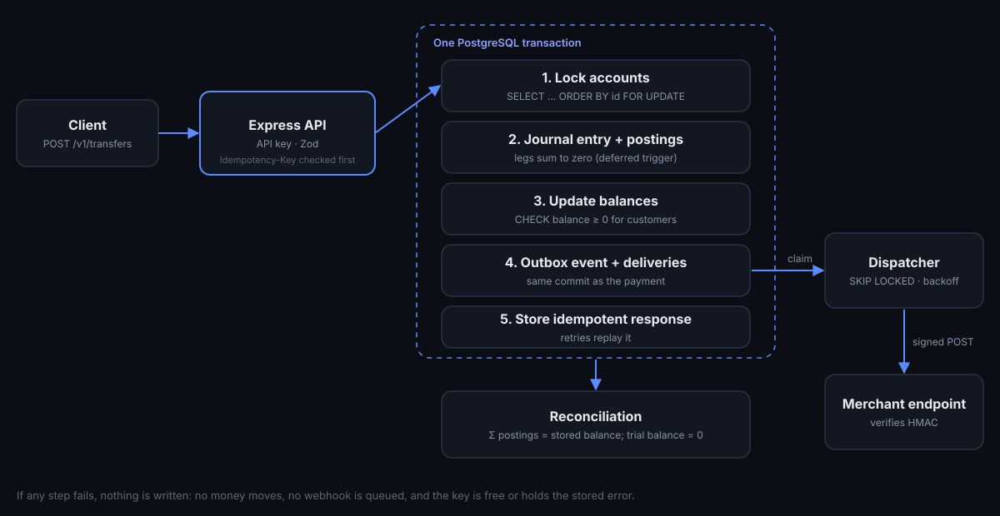

# PayLedger

**A double-entry payments ledger API you can try to break.** Transfers are idempotent, safe under concurrency and enforced by the database itself. Webhooks are signed, retried with backoff and never sent for a payment that didn't commit.

**[Open the live sandbox](https://payledger.onrender.com)** · [API docs](https://payledger.onrender.com/docs)

> Free hosting: if the first load takes ~30 seconds, the service is waking up.



## What the sandbox lets you do

- **Fire 20 transfers at once** from an account that can only afford a few. Exactly as many succeed as the balance allows; the rest are refused and the balance never goes below zero.
- **Send the same request twice** with one `Idempotency-Key`. The second returns the original response with `Idempotent-Replayed: true` and moves no money.
- **Make the webhook receiver flaky** and watch deliveries retry with exponential backoff, give up, and get replayed.
- **Reconcile the books**: every stored balance is recomputed from raw postings, and the whole ledger sums to zero.

## Design

### Double-entry, enforced twice

Every money movement is a journal entry with two or more postings that sum to zero. A transfer is three legs:

| Account | Posting |
|---|---|
| Sender | −(amount + fee) |
| Receiver | +amount |
| Fee revenue | +fee |

The application checks this, and **PostgreSQL enforces it independently**:

- a deferred constraint trigger rejects any entry whose postings don't sum to zero, or that has fewer than two;
- a `CHECK` constraint stops a customer balance from going negative;
- triggers make `journal_entries` and `postings` append-only. Corrections are new entries, never edits.

Amounts are `BIGINT` kobo end to end, parsed into JavaScript `BigInt`. No floats anywhere.

### Concurrency without overdrafts or deadlocks

Inside the transaction, every account an entry touches is locked with `SELECT … FOR UPDATE`, **always in ascending ID order**. Funds are checked against the locked balance, so two concurrent transfers can't both spend the same money. Because every transaction takes locks in the same order, transfers running in opposite directions queue instead of deadlocking. Both properties are covered by tests (30 simultaneous transfers; 40 transfers in opposite directions).

### Idempotency keys

`POST /v1/transfers` and `POST /v1/deposits` require an `Idempotency-Key` header.

- The key is reserved before work starts, and the response is stored **in the same transaction** as the ledger writes, so a committed payment always has its stored response.
- Same key and body: the stored response is replayed. Bodies are compared by a hash of canonical JSON, so key order doesn't matter.
- Same key, different body: `422 idempotency_key_reused`.
- Same key while the first is in flight: `409 request_in_progress`. A key stuck in progress for 60s (crashed request) can be taken over by exactly one retry.
- Business errors such as `insufficient_funds` are stored and replayed, like Stripe. Unexpected errors release the key.

### Webhooks: transactional outbox

The event and its delivery rows are inserted in the same transaction as the payment. If the payment rolls back, no webhook exists; if it commits, delivery is guaranteed.

- A dispatcher claims due deliveries with `FOR UPDATE SKIP LOCKED`, so several instances can run without double-sending. Claims expire after 30s if a process dies mid-send.
- Each request carries `PayLedger-Signature: t=<unix>,v1=<HMAC-SHA256(secret, "t.body")>`. Including the timestamp blocks replay of old payloads; receivers verify with a constant-time compare and a 5-minute tolerance.
- Failures retry at 2s, 4s, 8s, 16s, 32s, then the delivery is marked dead and can be replayed by hand. (Short on purpose for the demo; production would stretch over hours.)

### Reconciliation

Balances are maintained incrementally for fast reads. `GET /v1/reconciliation` proves they never drifted: it recomputes each balance from its postings and checks the trial balance is zero. A test tampers with a balance directly in SQL and confirms reconciliation catches it.

## API

| Method | Path | Purpose |
|---|---|---|
| POST | `/v1/sandbox` | New isolated workspace and API key (rate limited) |
| GET / POST | `/v1/accounts` | List or open customer accounts |
| GET | `/v1/accounts/:id/postings` | Statement with running balance |
| POST | `/v1/deposits` | Money in (idempotent) |
| POST | `/v1/transfers` | Customer to customer with fee (idempotent) |
| GET | `/v1/entries` | Journal entries with postings |
| GET | `/v1/reconciliation` | Balance and trial-balance check |
| GET / PATCH | `/v1/webhooks/endpoints` | Endpoint settings, demo failure rate |
| GET | `/v1/webhooks/deliveries` | Delivery status and retries |
| POST | `/v1/webhooks/deliveries/:id/retry` | Replay a failed delivery |

Full OpenAPI spec at [`/docs`](https://payledger.onrender.com/docs).

```bash
KEY=$(curl -s -X POST https://payledger.onrender.com/v1/sandbox | jq -r .api_key)
curl -s https://payledger.onrender.com/v1/accounts -H "Authorization: Bearer $KEY"

curl -s https://payledger.onrender.com/v1/transfers \
  -H "Authorization: Bearer $KEY" -H "Idempotency-Key: $(uuidgen)" -H "Content-Type: application/json" \
  -d '{"from_account_id":"acc_…","to_account_id":"acc_…","amount":250000}'
```

## Run locally

```bash
docker compose up -d          # PostgreSQL on :5433, with a payledger_test database
cp .env.example .env
npm install
npm run migrate
npm run dev:api               # API on http://localhost:4100
npm run dev:web               # dashboard on http://localhost:5180
```

## Tests

```bash
npm test
```

Unit tests cover fees, signatures, backoff and canonical hashing. Integration tests run against a real PostgreSQL and cover concurrency, idempotency (sequential and concurrent), database-level guarantees, reconciliation and the full webhook lifecycle. CI runs type-checking, the tests and the production build on every push.

## Stack

Node.js 22 · TypeScript · Express 5 · PostgreSQL (`pg`, hand-written SQL and migrations) · Zod · React 19 · Vite · Vitest · Supertest · Docker · GitHub Actions
